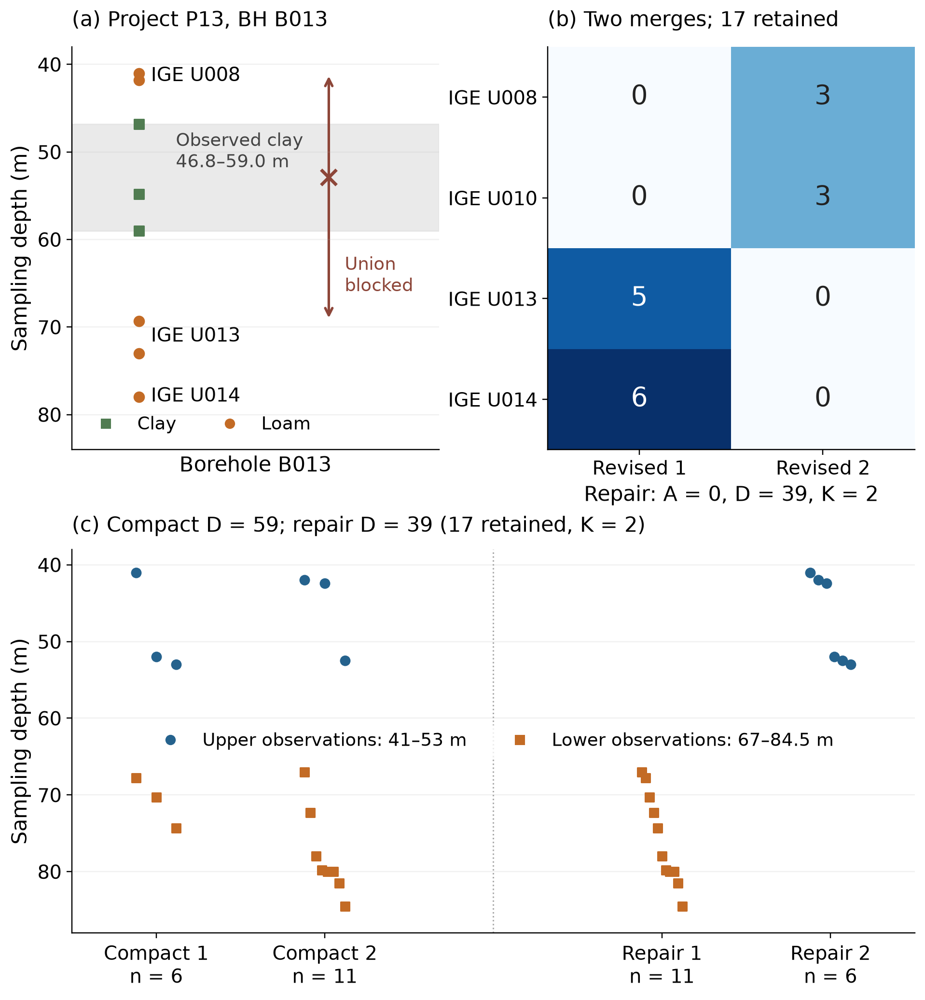

# EVCC-A

Code, data and notebooks for

> N. Tishin and O. Ozmidov. *Certified grouping of soil test results under variability and borehole continuity constraints.* Manuscript submitted for publication, 2026.

EVCC-A groups laboratory soil test results into engineering-geological units (IGE). A group is admissible only if

- every property passes a coefficient-of-variation limit and an extremum (outlier) limit,
- its members form one depth interval in each borehole, and
- no logged change of material separates them.

Specimens that fit no admissible group are referred for review instead of being forced into one. The grouping is chosen by exact set partitioning over the complete family of admissible groups, so each result is either a proven optimum or a proof that no admissible group exists.

Two objectives are available:

- **compact**: fewest referrals, then fewest groups;
- **repair**: fewest referrals, then fewest changes to an existing interpretation.



## Quick start

Python 3.11 or 3.12.

```bash
git clone https://github.com/tnick1502/evcc-a.git
cd evcc-a
python3.11 -m venv .venv
source .venv/bin/activate
pip install -r requirements.lock.txt
pip install -e . --no-deps

pytest -q        # about 1 min
evcca-verify     # checks the files in results/
```

Recompute every result from `data/` and compare with `results/`:

```bash
evcca-reproduce --output runs/full-study      # about 40 min on one CPU core
evcca-verify --run runs/full-study
evcca-figures --output runs/figures
```

The notebooks in `notebooks/` are executed and can be read on GitHub. To run them again:

```bash
jupyter nbconvert --to notebook --execute --output-dir runs/notebooks notebooks/*.ipynb
```

## Graph and spectral comparisons

Two multivariate proposal methods, Graph Ward and Spectral + COP, are run under the same gates and the same selection objective, but choose groups only from the candidates they generate. With a 5 % extremum reserve, EVCC-A groups every specimen in six of the 19 contexts and the proposal methods in three. Counting only contexts within the review budget of max(1, ⌊0.1 n⌋) referrals, the proposal methods keep 105 specimens and EVCC-A 120; at nominal limits the figures are 118, 119 and 120. [docs/comparators.md](docs/comparators.md) describes the protocol.

```bash
python -m evcca.study.comparators --output runs/graph-spectral    # about 2 min
python -m evcca.study.comparators --verify runs/graph-spectral
```

The same comparison under other review budgets, a much wider proposal search and a check of the interval enumeration against all subsets:

```bash
python -m evcca.study.robustness --output runs/robustness         # about 10 min on two cores
python -m evcca.study.robustness --verify runs/robustness
```

## Use on your own data

One row per specimen. Required columns: `sample_id`, `borehole_id`, `depth_m` and the property columns. Optional: `initial_ige` (the existing interpretation, needed for repair mode), `barrier_with_ids` (semicolon-separated specimens that may not share a group) and `fixed_geological_unit`.

```python
import pandas as pd
from evcca import Policy, solve_context, summarize

data = pd.read_csv("my_site.csv")
policy = Policy(properties=("rho", "e0", "cohesion", "modulus"), limits=(0.15, 0.15, 0.30, 0.30))

result, candidates = solve_context(data, policy)        # or mode="repair"
best = result["evcca"]
print(best.objective, best.optimal)                     # (referred, groups, tie-break), True
summary, table = summarize(data, best, policy)
```

`best.labels` gives the group of every row (-1 means referred for review). The model is described in [docs/model.md](docs/model.md).

## Paper to repository

| In the paper | File in `results/` | Notebook |
|---|---|---|
| Table 2, cohort results | `metrics.csv` | 02, §2.1 |
| Fig. 1, Tolsa case and hull certificate | `tolsa_projection_checks.csv`, `tolsa_hull_witnesses.json` | 02, §2.2 |
| Section 4.2, Tolsa gate ablations | `tolsa_ablations.csv` | 02, §2.2 |
| Fig. 2, P13 compact and repair groupings | `repair_depth_groups.csv`, `repair_depth_modes.csv` | 01, §1.6 |
| Table 3, property profiles | `profile_comparison.csv` | 03, §3.2 |
| Fig. 3, reserves | `reserve_grid.csv` | 03, §3.1 |
| Fig. 4, graph and spectral comparisons | `comparators/` | 02, §2.3 |
| Table 4, review budgets; wider proposal search | `robustness/` | 02, §2.3 |
| Section 2.4, interval enumeration against all subsets | `robustness/family_check.csv` | 02, §2.5 |
| Table 5, revision plans | `revision_plan_summary.csv`, `revision_plans.json` | 02, §2.4 |
| Table 6, problem size and run time | `scale_timing.csv` | 02, §2.6 |
| Supplementary material | see [results/README.md](results/README.md) | 01–03 |

## Repository layout

```
data/        inputs: anonymized project records and the FI-CLAY database
src/evcca/   the method (gates, enumeration, set partitioning, ordered comparator,
             revision plans, hull certificate)
src/evcca/study/   code that reproduces the article
notebooks/   executed analysis notebooks
results/     outputs reported in the article
figures/     article figures
tests/       tests
```

## Data

- **FI-CLAY** database, version 2 (Löfman and Korkiala-Tanttu, [10.5281/zenodo.5040083](https://doi.org/10.5281/zenodo.5040083)), CC BY 4.0.
- **Project records** from laboratory statements and a triaxial-test export of JSC MOSTDORGEOTREST. Project, borehole, source-unit and specimen identifiers are replaced by codes (`P13`, `B013`, `U010`, `P13-S0279`); measurements are unchanged.

See [data/README.md](data/README.md) for columns and units.

## Citation

```bibtex
@unpublished{tishin2026evcca,
  author = {Tishin, Nikita and Ozmidov, Oleg},
  title  = {Certified grouping of soil test results under variability and borehole continuity constraints},
  year   = {2026},
  note   = {Manuscript submitted for publication}
}
```

## License

Code: [MIT](LICENSE). Data and result tables: [CC BY 4.0](data/LICENSE).

Contact: Nikita Tishin, itishinn@gmail.com
